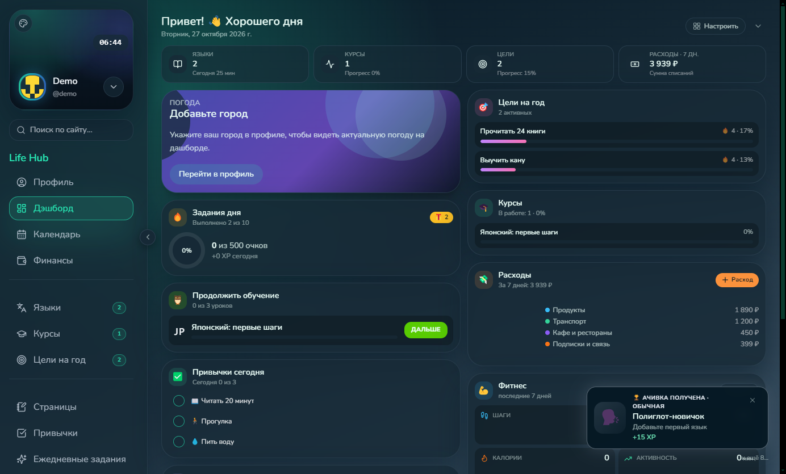
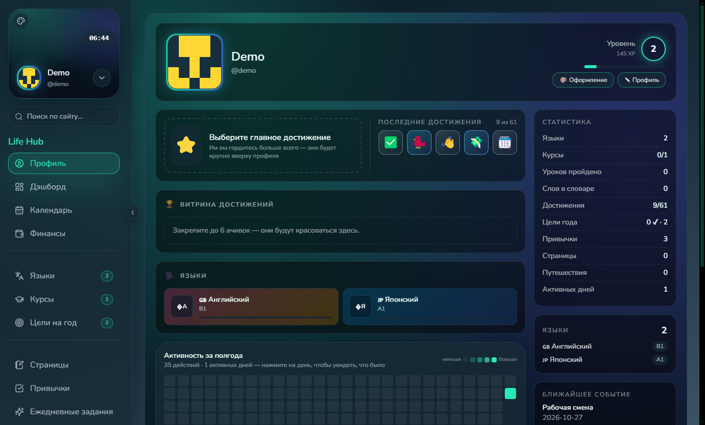
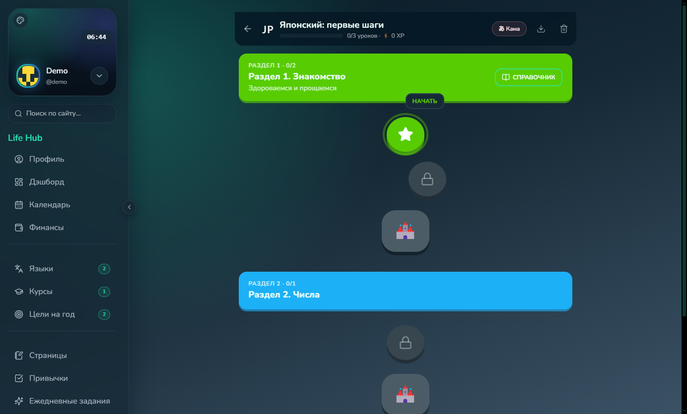
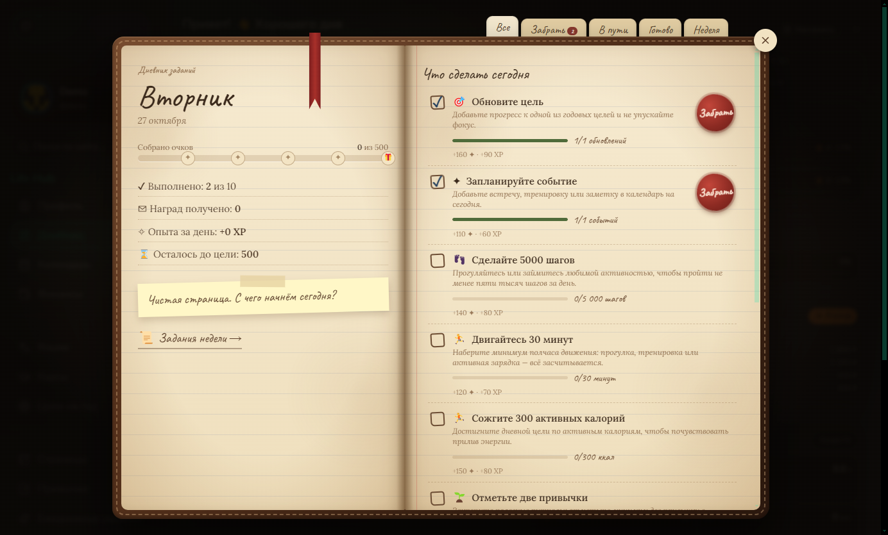

<div align="center">


# ✨ Life Hub

**Личный центр управления жизнью: языки, курсы, привычки, цели, финансы и ачивки — в вебе, на Windows и на Android.**

<p>
  
  
  
  
</p>


<br/><br/>

[⬇️ Скачать](https://github.com/tesutavt/Life-Hub/releases/latest) · [🐛 Сообщить об ошибке](https://github.com/tesutavt/Life-Hub/issues) · [💡 Предложить идею](https://github.com/tesutavt/Life-Hub/issues)

</div>


<details>
<summary><b>📑 Содержание</b></summary>

- [О проекте](#-о-проекте)
- [Скриншоты](#-скриншоты)
- [Возможности](#-возможности)
- [Технологии](#%EF%B8%8F-технологии)
- [Установка и запуск](#-установка-и-запуск)
- [Структура проекта](#-структура-проекта)
- [Планы](#%EF%B8%8F-планы)
- [Автор](#-автор)

</details>

## 📖 О проекте

Life Hub собирает в одном месте всё, что обычно разбросано по десятку приложений: изучение языков в стиле Duolingo, курсы, привычки, годовые цели, календарь смен, расходы по банковским выпискам и заметки. За любое действие начисляется опыт, растёт уровень, открываются ачивки, а ежедневные задания ведутся в уютном «дневнике».

Сервер один, а клиентов три: веб-версия, десктоп-приложение для Windows (со встроенным сервером — работает без интернета) и нативное Android-приложение с виджетами и напоминаниями. Телефон подключается к своему ПК или VDS по адресу или по QR-коду.

## 📸 Скриншоты

<p align="center">
  
  &nbsp;
  
</p>
<p align="center">
  
  &nbsp;
  
</p>

## 🌟 Возможности

- ✅ **Языки** — словарь, тренировки с интервальным повторением (SRS), тренажёр каны, стрик и дневная цель
- ✅ **Курсы-тренировки** — уроки в стиле Duolingo из JSON, контрольные в конце раздела, программа «какой курс после какого». Курс можно сгенерировать нейросетью по шаблону ([формат](docs/COURSE_FORMAT.md))
- ✅ **Задания** — ежедневные и еженедельные, в виде потёртого дневника; засчитываются сами по активности
- ✅ **Привычки, цели на год, календарь** — недельная сетка, авто-отметка целей по действиям, мастер смен 2/2, синхронизация с календарём телефона
- ✅ **Финансы** — импорт CSV-выписок банков, категории по MCC, кредиты, графики
- ✅ **Страницы** — заметки на свободном холсте: текст, вкладки, PDF, картинки, теги, глобальный поиск
- ✅ **Профиль в духе Steam** — уровень, витрины, главное достижение, «индекс жизни», фон профиля
- ✅ **Ачивки** — страница как в Steam, редактор и импорт через промпт для админа
- ✅ **Отчёты** — дневные, недельные и месячные итоги с графиками и экспортом в PNG
- ✅ **Напоминания** — уведомления Windows и Android, вход на телефоне по QR-коду, виджеты рабочего стола

## 🛠️ Технологии

<p align="left">
  
</p>

## 🚀 Установка и запуск

**Готовые сборки** — в [релизах](https://github.com/tesutavt/Life-Hub/releases/latest): установщик и portable-версия для Windows, APK для Android.

**Из исходников.** Требования: Node.js 18+, для Android — Android Studio / JDK 17.

```bash
# 1. Клонировать репозиторий
git clone https://github.com/tesutavt/Life-Hub.git
cd Life-Hub

# 2. Установить зависимости сервера и клиента
npm install
npm run install:all

# 3. Запустить в режиме разработки
npm run dev
# API:    http://localhost:4000
# Клиент: http://localhost:5173
```

Другие варианты:

| Что | Как |
|---|---|
| Windows в один клик | дважды кликнуть `start.cmd` — поставит зависимости, соберёт клиент и откроет `http://localhost:4000` |
| Десктоп-приложение | `npm run electron` — окно; `npm run electron:dist` — установщик в `electron/dist` |
| Свой сервер на VDS | `docker compose up -d --build`, подробно — [deploy/README.md](deploy/README.md) |
| Android | открыть папку `android/` в Android Studio, подробно — [android/README.md](android/README.md) |

Настройки сервера (порт, JWT, ключи Google Fit) — в `server/.env`, список переменных в [server/README.md](server/README.md).

## 📂 Структура проекта

```
Life-Hub/
├── server/       # Express + SQLite API, ачивки, задания, напоминания
├── client/       # React + Vite + Tailwind, веб-интерфейс
├── electron/     # десктоп-приложение со встроенным сервером
├── android/      # нативное приложение: Kotlin + Jetpack Compose
├── deploy/       # развёртывание на VDS (Caddy, systemd)
├── docs/         # формат курсов для импорта
├── screenshots/  # картинки для README
└── start.cmd     # запуск одним кликом на Windows
```

## 🗺️ Планы

- [x] Курсы в стиле Duolingo с контрольными и программой обучения
- [x] Финансы с импортом банковских выписок
- [x] Android-приложение с виджетами и синхронизацией календаря
- [x] Вход на телефоне по QR-коду
- [ ] Офлайн-режим для Android
- [ ] Редактирование страниц-холстов с телефона

## 💜 Автор

<table>
  <tr>
    <td align="center">
      <a href="https://github.com/tesutavt">
        <br/>
        <b>Tesuta</b>
      </a><br/>
      <sub>втубер · программист</sub>
    </td>
  </tr>
</table>


<p align="center">
  <i>Если проект понравился — поставь ⭐, мне будет приятно!</i>
</p>
